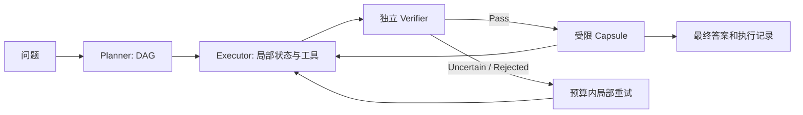

# SCOPE 项目背景、实现进度与后续任务

更新日期：2026-10-23。仓库：`ruidongxiong-spec/qc`，分支 `main`。

## 背景与已确定范围

使用 Python 复现用户论文 *From Trajectories to States: State-Constrained Plan Execution for LLM Agents* 的核心方案，支持远程运行、比较模型与展示执行证据。第二个创新点和完整前后端系统是后续研究任务，目前不宣称已完成。

论文针对长轨迹导致的上下文膨胀、错误传递和难以追溯：Planner 生成 DAG 子任务，Executor 维护局部状态，独立 Verifier 验证结果，只有通过的紧凑 Capsule 才向后继传播。超时、失败或拒绝的中间结果不能污染后续任务。

当前用户约束：

1. Python 技术栈；先交付复现代码与数据，之后进行真实远程实验。
2. HotpotQA 官方 fullwiki/train，按原始标签 easy 500 / medium 300 / hard 200，共 1,000。
3. MuSiQue 从官方 Ans dev 抽 2/3-hop 共 1,000：**2-hop 600 / 3-hop 400**，不含 4-hop。
4. Bamboogle 125 条保持不动。
5. **最新指示暂停逐题审阅，先提交完整 CSV、固定抽样、代码和进度文档**。未应用排除建议。
6. Windows D 盘需要副本；云环境不能直接访问用户电脑，通过同步脚本或 ZIP 安装。

## 实现方案与模块



| 模块 | 已实现 | 当前限制 |
|---|---|---|
| scope/core.py | DAG 调度、局部状态、验证状态、Capsule、依赖阻断、超时隔离、局部修复 | 独立实现，尚无作者原始代码/完整提示词对齐 |
| scope/backends.py | OpenAI 兼容 HTTP、角色 JSON 输出、调用耗时与 token usage | 演示后端是固定样例，尚未完成真实模型实验 |
| scope/tools.py | 工具分发、受限算术表达式 | 不是论文中的通用沙箱 python_repl |
| scope/retrieval.py | DDGS/SearXNG/Wikipedia/Serper；直接网页读取或 Jina；缓存和来源校验 | 先前在线搜索与 DNS 验证未通过，不能以离线测试代替在线验证 |
| scope/datasets.py | CSV/JSONL、答案别名、ID 与参考答案校验 | 评分需要答案，不能评分官方无标签 test |
| scope/benchmark.py | 模型矩阵、三次运行、恢复、配置指纹、逐题错误/时延/usage | 尚未产生真实准确率或模型排名 |
| scope/report.py | 静态 HTML 指标、执行事件、验证和证据展示 | 尚无持续运行的前后端、数据库和任务队列 |
| scope/curation.py | 固定分层抽样、来源/种子/审阅绑定、同难度替换及审计 | 用户已暂停，当前正式抽样未应用质量筛选 |
| scripts/export_official_hotpotqa.py | 官方全量完整字段分片、轻量 QA、500/300/200 抽样 | PyArrow 仅重建需要，已有 CSV 评分无需它 |
| scripts/export_musique.py、build_selected_dataset.py | 官方 MuSiQue 六份完整 CSV、600/400 抽样与合并版 | test 无标签；Full 有不可回答上下文，不用于本轮抽样 |
| scripts/setup-windows.ps1 | 默认 D:\qc 安装、显式安全更新、离线测试与演示 | 未在真实 Windows/PowerShell 验证 |

论文对齐仍有明确缺口：论文 Capsule 预算 **512 tokens**，当前是保守的 **512 bytes** 近似，二者不等价；还需对齐 8 步、15,000 字符验证日志、各角色温度、完整提示词与消融。节点/局部状态上限是工程设置；当前算术工具不等于隔离的 Python 执行环境。

## 数据交付进度

### 官方 HotpotQA

直接来自官方 Hugging Face 仓库，revision `1908d6afbbead072334abe2965f91bd2709910ab`。4 个 Parquet 已核对仓库 LFS SHA-256 和字节数。

| 划分 | 条数 | 标签 |
|---|---:|---|
| train | 90,447 | easy 17,972；medium 56,814；hard 15,661，有答案 |
| validation | 7,405 | 全 hard，有答案 |
| test | 7,405 | 没有公开 answer/level/type，不补造 |

根目录 `datasets/hotpotqa_fullwiki_*.csv` 为全部行的轻量 QA 视图。`datasets/official/hotpotqa_fullwiki/` 为包含全部原始 context/supporting_facts 的完整字段 CSV，约 634 MiB，共 34 个不超过 20 MiB 的分片，满足 GitHub 单文件限制。原字段、null 与空字符串可恢复；散列、文件数和来源见 `datasets/hotpotqa_fullwiki_manifest.json`。

`hotpotqa_train_sample1000.csv` 是新的固定 500/300/200 初抽，`scope_selected2125.csv` 合并它、官方 MuSiQue-Ans dev 新抽样 1,000（600/400）与原 Bamboogle 125。旧 `hotpotqa_sample1000.csv`、`scope_public_baseline2125.csv` 保留追溯，不能把旧全 hard 基线误当新抽样。

### MuSiQue 和 Bamboogle

- 已从作者 Google Drive 直接取得完整 v1.0 ZIP（SHA-256 `98f839bf2fd5319f5c688aed77901a6d5c30b3b9f9f691ab9a8ecafb045ee0cd`）。
- 完整字段含证据段落、问题分解、答案别名：`official/musique_ans/` train 19,938 / dev 2,417 / test 2,459；`official/musique_full/` train 39,876 / dev 4,834 / test 4,918。共 45 个不超过 20 MiB 的 CSV 分片。
- Ans 全量轻量 QA：`musique_ans_{train,dev,test}.csv`。test 原本无公开答案；Full 包含有意构造的不可回答上下文，不混入普通 QA 样本。
- `musique_ans_dev_2_3hop.csv` 有 2,012 条；新 `musique_ans_dev_sample1000.csv` 固定 600 条 2-hop、400 条 3-hop，无 4-hop，已接入 `scope_selected2125.csv`。
- 旧 `musique_dev.csv`、`musique_2_3hop.csv`、`musique_sample1000.csv` 是镜像 QA 基线，最后一份仍为旧 500/500，保留追溯，不作为新默认。详见 [MuSiQue 数据说明](musique-datasets.md)。
- `bamboogle.csv` 的 125 条内容与顺序保持不变，新合并版对应行也一致。
- 原数据许可不改为项目代码许可，来源和许可见 `datasets/README.md` 与各 manifest。

这些是本项目固定的公开数据基线，不是 SCOPE 作者公开的原始 ID 清单，不能承诺精确复现论文数值。当前 Web 检索也不同于固定 Wikipedia 语料的 fullwiki 官方评测。

### 暂停的质量审阅

新 HotpotQA 初抽 1,000 及额外 260 候选已做首轮题意阅读，仍有待支持句复核的备注。它是助手判断，不是独立人工标注或全部答案核验。根据用户要求，现在暂停，**没有应用剔除，没有发布 clean1000**。

`datasets/hotpotqa_train_review/` 对应新 train；`datasets/audit/` 对应旧 dev/MuSiQue 的未应用草稿。它们绑定不同来源与 ID，不互相套用，不包含 Bamboogle 的替换决定。

## 运行、验证与实验状态

Python 3.12 云环境可运行项目，当前 **43 项测试通过**。测试覆盖状态隔离、伪造证据阻断、失败记录、断点恢复、数据输入、全量 CSV 散列、完整字段/空值往返、抽样配额、Bamboogle 保持与未审阅冻结拒绝。复验命令：

```bash
python -m unittest discover -s tests -v
python -m scope.cli demo --output runs/demo.json
python -m scope.report --input runs/demo.json --output runs/demo.html
```

真实批测使用新输入；需先在环境设置安全填写实际 endpoint、model ID 与 key：

```bash
python -m scope.benchmark --models examples/models.json \
  --input datasets/scope_selected2125.csv --output runs/real-models --runs 3
```

models.json 内模型仍为占位，不能直接当作可用模型清单。用户允许以后补充模型服务；尚未运行收费批次，也未生成任何真实模型排名。免费 OpenRouter 模型的可用性、限额与完整 ID 需要在实验时确认。密钥不入 Git，也不要发到聊天。

独立模型比较和展示文档仍为 `docs/model-performance.md`、`docs/system-demo.md`。Serper 的免费替代为 DDGS、自建 SearXNG 或限定域 Wikipedia；Jina 的免费替代为直接 HTTP + Trafilatura。它们在覆盖、反爬和稳定性上不同，仍需在线端到端验证。本轮已恢复 Hugging Face 下载，不能据此推断任意网页搜索已验证。

## D 盘与远程同步

本云工作区与远程 main 提交相同文件；用户 Windows 电脑不在本环境中，不能声称已直接写入 D 盘。首次 clone 到 `D:\qc`，已有干净 Git 工作副本可运行：

```powershell
powershell -ExecutionPolicy Bypass -File D:\qc\scripts\setup-windows.ps1 -Destination D:\qc -Update -FreeWeb
```

`-Update` 检查 origin、main 与无本地改动，只允许 fast-forward；不 reset，不覆盖用户修改。`-DatasetPrep` 仅重建数据时安装额外依赖，正常评分已有 CSV 不需重下 Parquet。ZIP 副本没有 `.git`，请重新解压新版更新，不能使用 `-Update`。Windows 命令尚未实际执行验证。

## 后续任务与优先级

1. **模型与在线链路**：确认可用模型、完整 ID 和安全密钥，验证搜索→读取→执行→验证，记录限流、配额和错误；先少量题，再完整批测。
2. **对齐论文**：按真实 tokenizer 计算 Capsule token；对齐提示词、温度、日志截断、8 步预算与消融；设计隔离、限制资源的 Python 沙箱。
3. **正式模型比较**：冻结来源、样本、模型、工具、预算与提示词；在同条件下跑 SCOPE/基线与 3 次重复；报告各数据集、难度、hop 的 EM/F1、耗时、usage、失败率与波动。
4. **恢复数据清理时**：回看原支持句，复核现有建议，避免误删多跳关系题；同源同难度补足，单独发布清理版、ID 和替换理由，保留初抽对照。
5. **数据版本冻结**：本轮 MuSiQue 官方六份 raw 已补齐并导出；正式实验记录新 manifest、600/400 样本与合并版散列，禁止混用旧镜像 500/500；Full 的不可回答评测另行设计。
6. **前后端展示**：从静态报告起步，根据需求建立任务 API、持久化日志、后台任务和 DAG/证据/Capsule 视图，不为复杂而无依据增加组件。
7. **第二创新点**：以真实错误分析选择验证置信度校准、自适应预算或证据压缩等方向；先设假设、对照和消融，不把未实验方向写成成果。
8. **环境与发布**：在用户 D 盘和目标远程机实测；完善 CI、锁定依赖、启动检查、实验配置和发布包散列。密钥、缓存、运行日志继续不入 Git。
