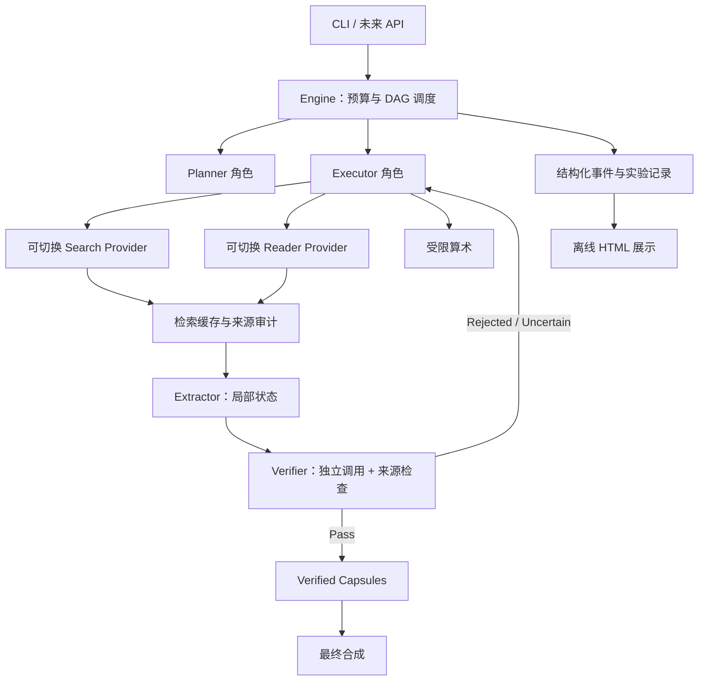

# 文件二：系统展示、架构审视与免费工具调研

## 架构结论

当前阶段适合“模块化单进程 Python 研究系统”：把规划、执行、验证、检索、评测和展示的边界明确即可。LLM 调用已经较慢，增加微服务、队列、分布式数据库会引入更多实验变量；先补齐约束和可观测性。多人同时提交任务、需要后台长任务时，再考虑 FastAPI + 作业队列 + 持久化存储。



这些 Agent 是隔离提示词/调用角色，默认复用同一个模型客户端，**不是多个独立模型或服务**。是否混用更强 verifier 是未来受控实验，不应悄悄改变基线。

## 本次模块完善

| 模块 | 已落地 | 仍需完善 |
|---|---|---|
| 规划 | DAG 校验、最大节点预算、依赖完整性 | 规划修复、约束覆盖率、复杂问题基准 |
| 执行 | 每步一次动作、格式错误反馈/预算内重试 | 更严格 JSON Schema、独立角色预算 |
| 状态 | findings 追加、来源校验、状态大小上限 | 真 tokenizer、有引用依赖的状态精简 |
| 验证 | 三态裁决、拒绝/不确定反馈、证据来源门控 | 逐约束结构化 checks、外部反证、校准 |
| 记忆 | 仅 Pass 传播、超时 partial 隔离 | 持久化检查点、撤回/版本关系 |
| 工具 | 四种搜索提供者、两种读取器、缓存/审计 | robots 策略、JS/PDF 读取、完整隔离 Python |
| 模型 | JSON 客户端、独立调用耗时与 usage | 流式、限流退避、token 上限、角色路由 |
| 评测 | 矩阵、续跑、错误率、EM/F1、token/延迟 | 统一 judge、置信区间、基准导入 |
| 展示 | 可打开的离线 HTML、状态/证据/事件 | 真正交互 DAG、在线任务 API、用户权限 |

来源门控只能阻止引用“从未观察到的来源”，不能证明句子被来源蕴含；语义正确性仍依赖 verifier 和独立评测。公开 HTTPS URL 和重定向会检查私网地址，但这不是部署在不可信多租户网络中的完整 SSRF 防线；远程部署仍应使用网络出口策略。

## 免费替代调研

本次通过官方 GitHub 仓库读取文档；部分官网/API 在云环境出口策略下返回 403，因此不声称全部 live 服务已验证。没有尝试绕过网络限制。实际 probe 中 DDGS 未取到结果，direct reader 在公开地址 DNS 检查阶段失败；当前环境不支持宣称免费联网通路已就绪。Trafilatura 的真实库提取已用固定 HTML 验证。

| 方案 | 替代对象 | 密钥/成本 | 适用性与限制 | 当前接入 |
|---|---|---|---|---|
| DDGS，固定 duckduckgo backend | Serper | 无必需 API key | 开发联调；非官方搜索接口，限流/反爬/结果漂移，不能保证服务可用 | 是，默认搜索 |
| 自建 SearXNG | Serper | 软件开源，部署机器有成本 | 广域搜索可控；需开启 JSON，公共实例常禁用格式或限流 | 是，需要实例 URL；未自动部署 |
| Wikipedia Search API | Serper 的部分用途 | 无必需 key | 只搜百科，适合部分多跳事实题；不等价于全网检索 | 是，可选 |
| Trafilatura + 直接 HTTP | Jina Reader | 本地开源库，无按次 API 费用 | 普通 HTML 正文；不运行 JS，不处理验证码、登录墙或 PDF | 是，默认读取 |
| Jina Reader 公共服务 | 保留原读取方式 | 官方仓库说明可免费使用，有限流；实时额度以服务为准 | 可处理更多渲染/文档类型；真实调用仍需验证 | 是，可选 |
| Serper | 保留论文原设置 | 账户/额度政策以官网为准 | 正式论文对照仍可保留 | 是，可选 |

依据：
- [SearXNG Search API 官方文档源](https://github.com/searxng/searxng/blob/master/docs/dev/search_api.rst)：GET /search?q=...&format=json；未开启格式会 403。
- [DDGS 官方仓库](https://github.com/deedy5/ddgs)：支持指定 backend、region、timeout；固定 backend 避免自动换引擎成为隐含变量。
- [Trafilatura 官方仓库](https://github.com/adbar/trafilatura) 与 [PyPI](https://pypi.org/project/trafilatura/)：本地正文提取。
- [Jina Reader 官方仓库](https://github.com/jina-ai/reader)：Reader、免费使用说明、速率限制链接及自托管说明。
- [MediaWiki Search API](https://www.mediawiki.org/wiki/API:Search)：百科范围检索；本次官网访问被策略阻断，适配器尚未 live 验证。

安装免费扩展：`python -m pip install -e ".[free-web]"`。直接依赖版本已固定；`requirements-free-web.lock` 锁定当前测试环境的传递依赖版本，Windows 还需验证对应 wheel/安装兼容性。

建议本地用 DDGS + direct；远程较稳定实验用自建 SearXNG + direct，并对动态页面按实验分组明确切到 Jina。**不做静默自动 fallback**：工具失败留在事件里，避免不同实验暗中使用不同服务。页面访问须遵守目标站点条款、robots 和访问频率；当前 reader 未自动实现 robots 检查，不适合无人监管的大规模抓取。

## 展示方式

```bash
python -m scope.cli demo --output runs/demo.json
python -m scope.report --input runs/demo.json --output runs/demo.html
```

打开生成的 HTML 即可展示：问题/答案、节点依赖、Pass/Uncertain/Blocked、Capsule 结果、证据、验证摘要与事件顺序。页面对内容做 HTML 转义，不引入 CDN。它是**静态回放**，没有在线提交任务或实时交互 DAG；不把它当完整前后端系统。

汇报建议：先展示“错误上游被拒绝，不传播”；再展示“补充证据后局部重试成功”；最后展示同数据上的模型对比与失败率。离线 fixture 需明确标注，不冒充真实推理。当前 demo 的成功路径是 fixture；失败/重试路径在测试中验证，尚未制作单独的汇报样例。

## Windows D 盘

当前云会话不能直接写你电脑的 D 盘。下载项目压缩包并解压为 `D:\qc`，或运行：

```powershell
git clone --branch main https://github.com/ruidongxiong-spec/qc.git D:\qc
powershell -NoProfile -ExecutionPolicy Bypass -File D:\qc\scripts\setup-windows.ps1 -FreeWeb
```

这里 Bypass 仅作用于本次 PowerShell 进程，不修改系统策略。如已有 D:\qc，请先保留本地改动，脚本不会覆盖或自动拉取。需要预装 Git 和 Python 3.11+（带 py launcher）。Linux 云端已验证 Python 流程，PowerShell 脚本在当前无 PowerShell 的机器上未执行；首次 Windows 安装需确认系统兼容性。
